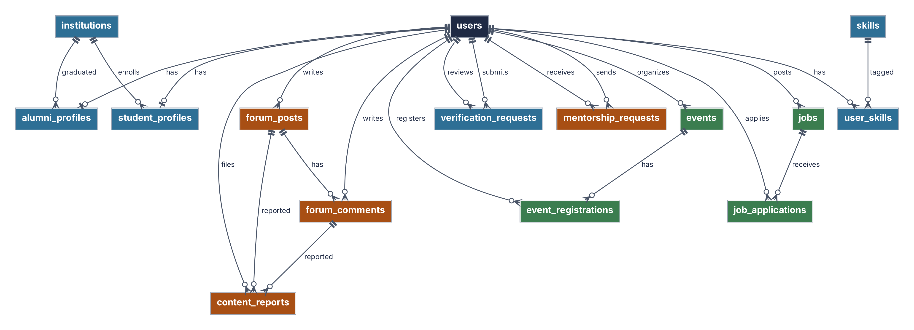
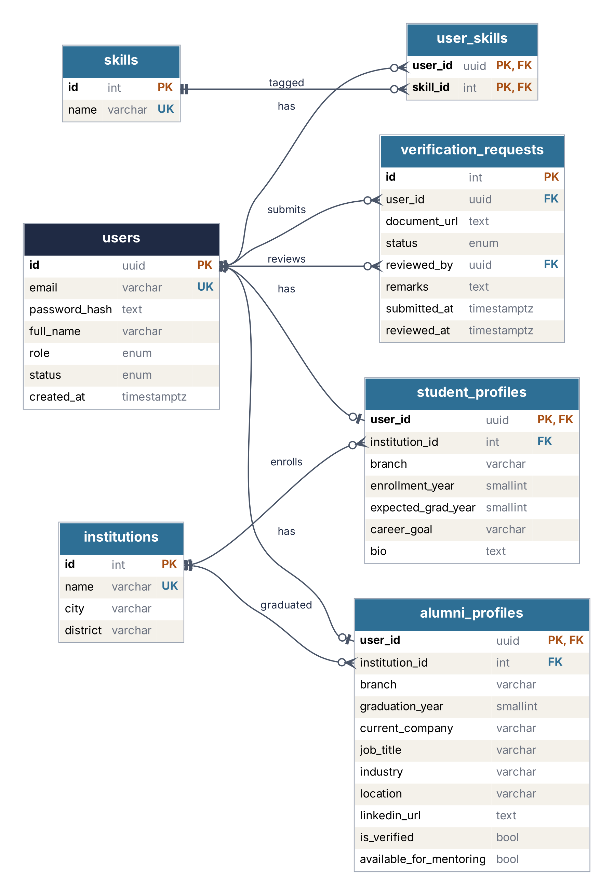
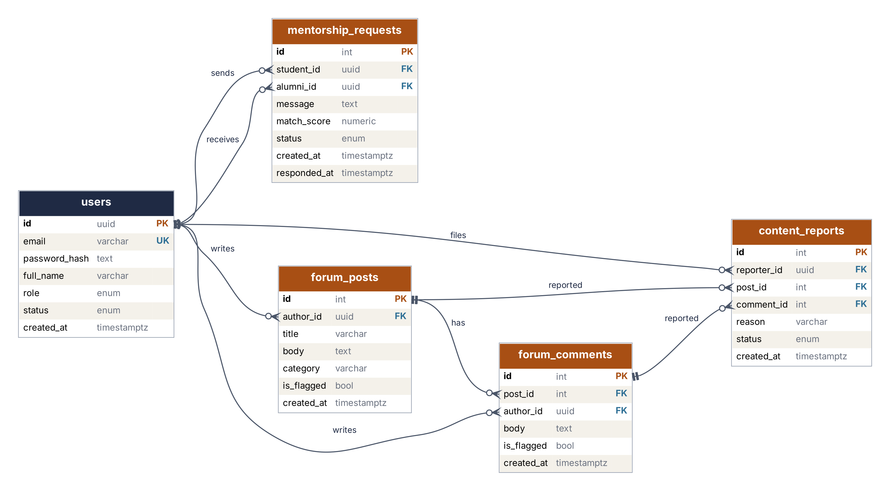
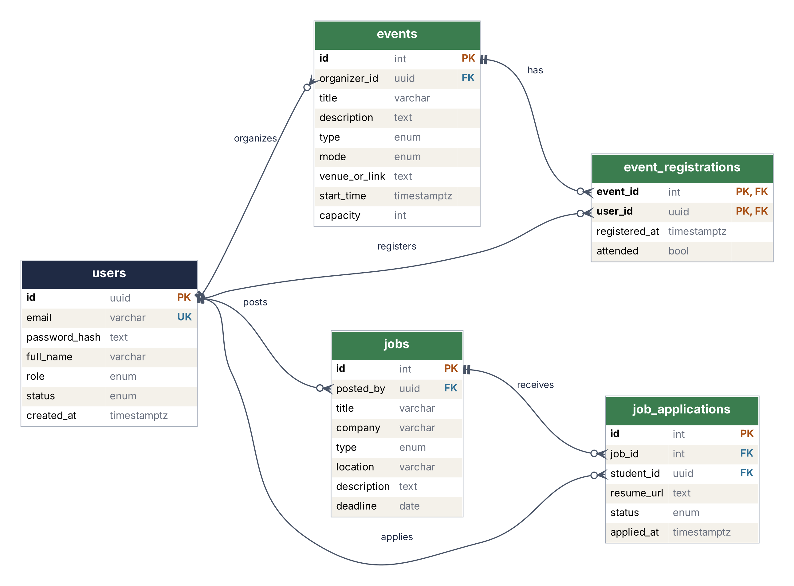

# AlumSetu

**A bridge between students and alumni of technical institutions in Rajasthan.**

AlumSetu is a web platform where current students connect with verified alumni for mentorship, career guidance, events and job referrals, backed by a central alumni database and AI-suggested mentor matches.

> Capstone project for **Advanced Programming (AP)** and **Data Engineering (DE)**, Newton School of Technology.
> Problem statement: SIH 2024, *Intelligent platform to interconnect Alumni and Students*, Technical Education Department, Govt. of Rajasthan.

## Live

| | Link |
|---|---|
| Website | *(Vercel link, added once deployed)* |
| API | https://alumsetu-api.onrender.com/api · [health check](https://alumsetu-api.onrender.com/api/health) |

Demo accounts (student, verified alumni, admin) are listed in [`docs/DEPLOYMENT.md`](docs/DEPLOYMENT.md); the password is shared with evaluators on request.
The API runs on Render's free plan, so the first request after a quiet period takes about a minute.

Check the live server end to end (from `server/`):
```
API_URL=https://alumsetu-api.onrender.com/api DEMO_PASSWORD='...' npm run smoke-test
```

---

## Features

| Feature | Description |
|---|---|
| Role-based login | Student, Alumni and Admin accounts (JWT) |
| Profiles | Education, batch, company, skills |
| Alumni directory | Search by institution, branch, batch, company, skill |
| AI mentor matching | Suggests best-fit alumni based on skills and career goals |
| Mentorship | Request, accept or decline, and track status |
| Forum | Posts and comments with auto-moderation and reporting |
| Events | Meetups, webinars, panels, with registration |
| Jobs and referrals | Alumni post openings, students apply |
| Verified alumni | Admin approves proof documents to stop fake profiles |

**End goal:** a responsive website, deployed live on the cloud.

## Tech Stack

- **Frontend:** React (Vite), React Router, Tailwind CSS
- **Backend:** Node.js, Express, JWT, bcrypt, Zod, Winston
- **Database:** PostgreSQL (hosted on Neon)
- **Hosting:** Vercel (client), Render (server), Neon (database), Cloudinary (file uploads)

Full justification: [`docs/STAGE1.md`](docs/STAGE1.md)

- API contract: [`docs/API.md`](docs/API.md)
- Build roadmap: [`docs/ROADMAP.md`](docs/ROADMAP.md)

## Database

15 tables in PostgreSQL, normalised to 3NF.

**Overview** (blue = users and profiles, orange = mentorship and forum, green = events and jobs)



**Module 1: Users and profiles**



**Module 2: Mentorship and forum**



**Module 3: Events and jobs**



- Full diagram (all tables and columns): [`docs/er-diagram.png`](docs/er-diagram.png) · [SVG](docs/er-diagram.svg)
- SQL schema: [`database/schema.sql`](database/schema.sql)
- Diagram generator (Graphviz): [`docs/er/generate_er.py`](docs/er/generate_er.py)
- Mermaid source: [`docs/er-diagram.mmd`](docs/er-diagram.mmd)

## Project Structure

```
alumsetu/
├── client/                 React frontend (Vite + Tailwind)
│   └── src/
│       ├── components/     UI kit (ui/) and feature components
│       ├── context/        Auth and toast state
│       ├── hooks/          useApi, useAdminList, useCanPost
│       ├── layouts/        Page shell (navbar + footer)
│       ├── pages/          One file per screen (admin/, events/, jobs/, forum/ ...)
│       ├── routes/         App routes and role-based ProtectedRoute
│       ├── services/       api.js (fetch wrapper, uploads)
│       └── utils/          Date formatting
├── server/                 Express backend
│   ├── src/
│   │   ├── routes/         URL → middleware → controller
│   │   ├── controllers/    Read the request, call a service, send the response
│   │   ├── services/       Business rules and SQL
│   │   ├── validators/     Zod schemas for body, query and params
│   │   ├── middleware/     Auth, validation, file upload, errors
│   │   ├── config/         Database connection
│   │   ├── data/           Blocked-word list for moderation
│   │   ├── scripts/        create-admin
│   │   └── utils/          Errors, JWT, logger
│   └── tests/              node:test + Supertest
├── database/
│   ├── schema.sql          PostgreSQL schema
│   ├── seed.sql            Colleges and skills
│   └── sample-*.sql        Demo data (development only)
└── docs/
    ├── STAGE1.md           Problem, features, architecture, stack
    ├── API.md              Every endpoint with examples
    ├── ROADMAP.md          Stage 2 build plan
    ├── er-diagram.*        Full ER diagram (png, svg, mermaid)
    └── er/                 Overview + module ER diagrams
```

## Getting Started

**Prerequisites:** Node.js 18+, a free Neon PostgreSQL database, a free Cloudinary account.

Backend:
```bash
cd server
npm install
cp .env.example .env
npm run dev
```
Then open http://localhost:5050/api/health

Frontend (in a second terminal):
```bash
cd client
npm install
npm run dev
```
Then open http://localhost:5173

Database: open the Neon SQL editor and run, in order: `database/schema.sql`, `database/seed.sql`, and (for development only) `database/sample-data.sql`, `database/sample-students.sql` and `database/sample-content.sql`.

Check the connection with `npm run db:check` inside `server/`.

Run the automated tests with `npm test` inside `server/` (118 tests). The integration tests need `DATABASE_URL` in `server/.env`; they create temporary users with `@test.alumsetu.dev` emails and delete everything they create when they finish.

Protected endpoints need `Authorization: Bearer <token>` from `POST /api/auth/login`. For quick local testing you can instead send `X-Dev-User-Id: <user uuid>`; this is ignored when `NODE_ENV` is `production`. Create the first admin with `npm run create-admin` inside `server/`.

## Team

| Member | Role |
|---|---|
| Ashmita Kamath | Team lead · backend · database · AI matching |
| Siddhanth S Shiraguppi | Frontend · UI/UX |
| Dhanishtha | Auth and admin · moderation · deployment · docs |

## Milestones

- [x] **Stage 1 (13–24 Oct):** ideation, architecture, ER diagram, repo
- [x] Auth and profiles
- [x] Directory, mentorship, AI matching
- [x] Forum, events, jobs, admin panel
- [x] API deployed on Render, database on Neon, private uploads on Cloudinary (smoke test: 17/17)
- [ ] Website on Vercel
- [ ] **Stage 2 (26 Nov – 4 Dec):** integration, presentation

## Credits and Attribution

- Problem statement: Smart India Hackathon 2024 (Govt. of Rajasthan)
- Libraries: React, Vite, Express, pg, jsonwebtoken, bcrypt, Zod, Winston, Morgan, Tailwind CSS, Cloudinary SDK
- Diagrams: Graphviz, Mermaid
- AI tools: Claude (Anthropic) was used as a coding and documentation assistant. All changes were reviewed by the team through pull requests.

## License

MIT
