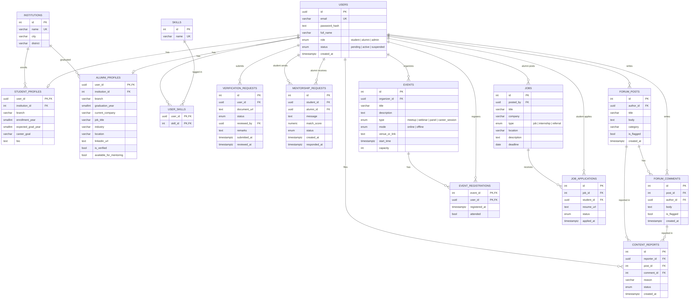

# AlumSetu 🌉

**A bridge between students and alumni of technical institutions in Rajasthan.**

AlumSetu is a web platform where current students connect with verified alumni for mentorship, career guidance, events and job referrals, backed by a central alumni database and AI-suggested mentor matches.

> Capstone project for **Advanced Programming (AP)** and **Data Engineering (DE)**, Newton School of Technology.
> Problem statement: SIH 2024, *Intelligent platform to interconnect Alumni and Students*, Technical Education Department, Govt. of Rajasthan.

---

## ✨ Features

| Feature | Description |
|---|---|
| 🔐 Role-based login | Student, Alumni and Admin accounts (JWT) |
| 👤 Profiles | Education, batch, company, skills |
| 🔎 Alumni directory | Search by institution, branch, batch, company, skill |
| 🤖 AI mentor matching | Suggests best-fit alumni based on skills and career goals |
| 🤝 Mentorship | Request, accept or decline, and track status |
| 💬 Forum | Posts and comments with auto-moderation and reporting |
| 📅 Events | Meetups, webinars, panels, with registration |
| 💼 Jobs and referrals | Alumni post openings, students apply |
| ✅ Verified alumni | Admin approves proof documents to stop fake profiles |

**End goal:** a responsive website, deployed live on the cloud.

## 🧱 Tech Stack

- **Frontend:** React (Vite), React Router, Tailwind CSS
- **Backend:** Node.js, Express, JWT, bcrypt, Zod, Winston
- **Database:** PostgreSQL (Supabase)
- **Hosting:** Vercel (client), Render (server), Supabase (DB and storage)

Full justification: [`docs/STAGE1.md`](docs/STAGE1.md)

## 🗂️ Database

15 tables in PostgreSQL, normalised to 3NF.



- SQL schema: [`database/schema.sql`](database/schema.sql)
- Mermaid source: [`docs/er-diagram.mmd`](docs/er-diagram.mmd)

## 📁 Project Structure

```
alumsetu/
├── client/            React frontend (Vite)
│   └── src/
├── server/            Express backend
│   └── src/
│       ├── routes/
│       ├── controllers/
│       ├── middleware/
│       ├── services/
│       └── utils/
├── database/
│   └── schema.sql     PostgreSQL schema
└── docs/
    ├── STAGE1.md      Problem, features, architecture, stack
    └── er-diagram.*   ER diagram (png, svg, mermaid)
```

## 🚀 Getting Started

**Prerequisites:** Node.js 18+, a free Supabase project.

Backend:
```bash
cd server
npm install
cp .env.example .env
npm run dev
```
Then open http://localhost:5000/api/health

Frontend (in a second terminal):
```bash
cd client
npm install
npm run dev
```
Then open http://localhost:5173

Database: open the Supabase SQL editor, paste `database/schema.sql`, and run it.

## 👥 Team

| Member | Role |
|---|---|
| Ashmita Kamath | Team lead · backend · database · AI matching |
| Sid | Frontend · UI/UX |
| Dhani | Auth and admin · moderation · deployment · docs |

## 🗓️ Milestones

- [x] **Stage 1 (13–24 Oct):** ideation, architecture, ER diagram, repo
- [ ] Auth and profiles
- [ ] Directory, mentorship, AI matching
- [ ] Forum, events, jobs, admin panel
- [ ] **Stage 2 (26 Nov – 4 Dec):** integration, live deployment, presentation

## 📚 Credits and Attribution

- Problem statement: Smart India Hackathon 2024 (Govt. of Rajasthan)
- Libraries: React, Vite, Express, pg, jsonwebtoken, bcrypt, Zod, Winston, Morgan, Tailwind CSS
- Diagrams: Mermaid
- AI tools: Claude (Anthropic) was used to help with planning, documentation and the database design draft. All code and design are reviewed by the team.

## 📄 License

MIT
